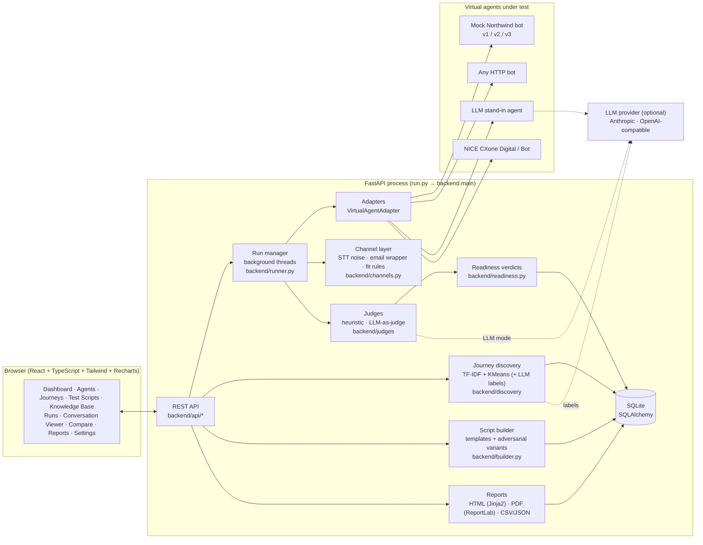
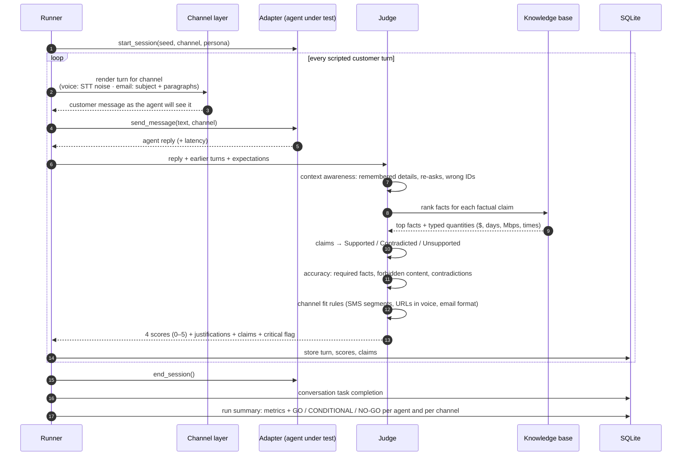

# AgentProof architecture

AgentProof is a single Python process: FastAPI serves a JSON API under `/api` and the pre-built React
app (`frontend/dist`) at `/`. Everything is stored in one SQLite file (`data/agentproof.db`).
Secrets live only in the local `.env` file.

## Components

## Scoring pipeline (one conversation)

## Judge modes

| Mode | When | How |
|------|------|-----|
| **Offline heuristic** | Always available; default when no API key | Typed-quantity extraction (money, durations, speeds, times, ordinals), content-word overlap and RapidFuzz similarity against KB facts, regex entity tracking (account numbers, ZIP codes, plans, amounts) across turns. |
| **LLM-as-judge** | `ANTHROPIC_API_KEY` or `OPENAI_API_KEY` set and judge mode `auto`/`llm` | Strict rubric prompt with the full KB, conversation history and expectations; JSON output validated with Pydantic; up to 3 attempts with the validation error fed back. OpenAI-compatible calls use temperature 0 (current Claude models don't accept sampling parameters). |
| **Fallback** | LLM call fails (bad key, network, refusal, invalid JSON ×3) | A per-run circuit breaker switches the rest of the run to the heuristic judge; turns are labelled `heuristic (LLM fallback)` and the UI shows the offline banner. |

In both modes the **hallucination score** is computed from the claim table with the same formula
(`5 − 3 × contradicted − 2 × unsupported`, floor 0) and **channel fit** uses the same deterministic rules,
so runs judged by different modes stay comparable.

## Readiness verdict

Each threshold (editable in Settings) is checked per run and per channel:

| Metric | Default | Conditional band |
|---|---|---|
| Average accuracy | ≥ 4.0 | down to 3.5 |
| Context awareness (turns that need earlier context) | ≥ 4.0 | down to 3.5 |
| Hallucination rate (turns with any non-supported claim) | ≤ 2% | up to 4% |
| Channel fit | ≥ 3.5 | down to 3.0 |
| Task completion | ≥ 80% | down to 70% |
| Critical failures | 0 | none, any is NO-GO |

**GO** means every threshold is met. **CONDITIONAL** means only soft misses inside the bands. **NO-GO** means any wider miss or any critical failure.
A **critical failure** is a contradicted fact, forbidden content, asking for a password, an empty reply or an answer that is mostly wrong.

## Data model

`KBFact` · `Transcript` → `Journey` → `TestScript` · `Agent` → `Run` → `Conversation` → `Turn` → `Claim` · `AppSetting`

Runs store a snapshot of agent name, script name and journey name, so history stays readable after edits or deletions.

## Packaging

* `start.bat` / `start.sh`: create `.venv`, install pinned `requirements.txt` (only when it changes), copy `.env.example`, then run `run.py`.
* `run.py` picks the next free port if 8000 is busy, detects an already running AgentProof, and opens the browser once `/api/status` answers.
* `agentproof.spec` + `build_exe.bat`: PyInstaller one-file `AgentProof.exe` bundling the backend, `frontend/dist`, templates and sample data. User data (`.env`, `data/`) is kept next to the exe.
